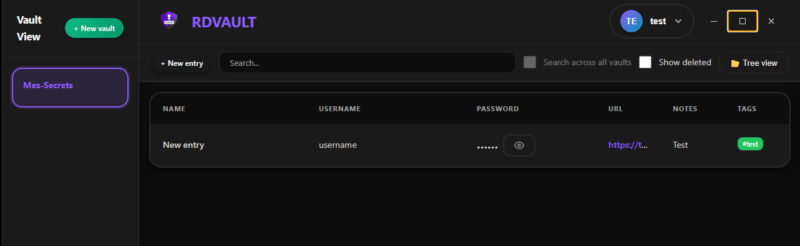
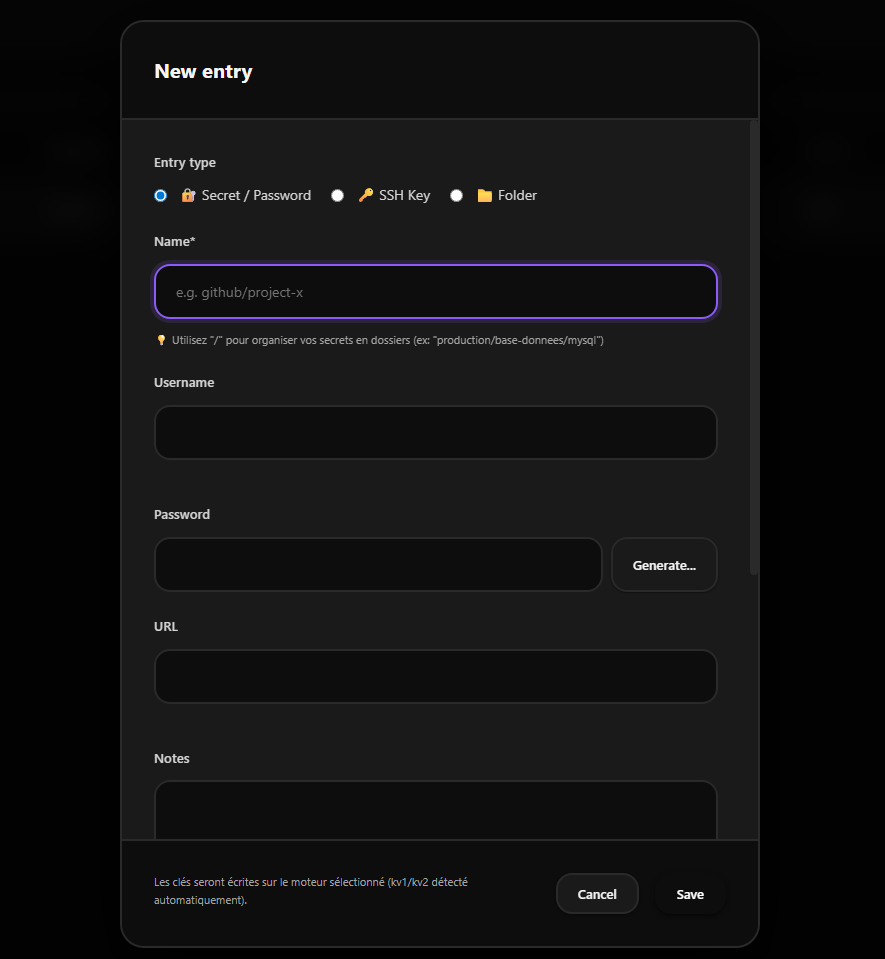
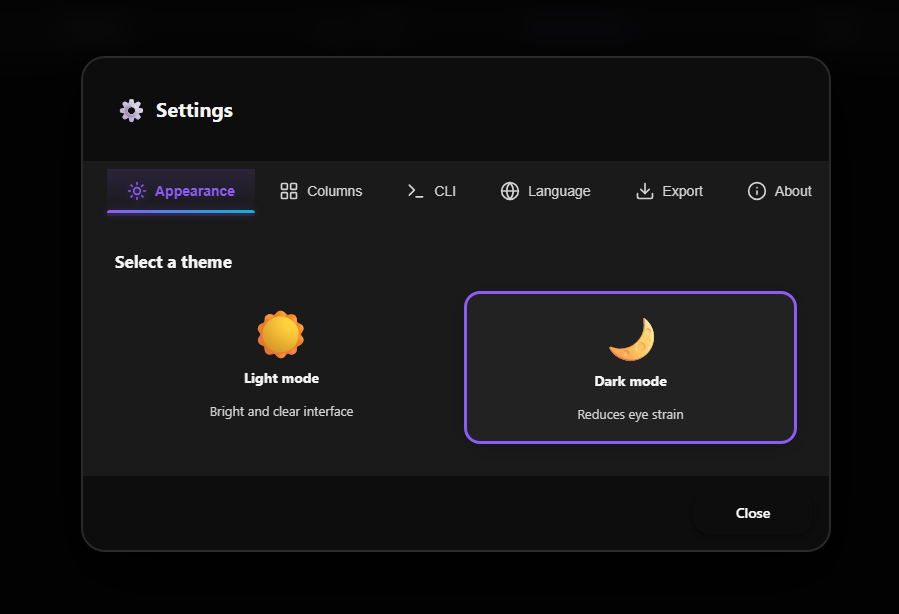

# RDVAULT

A modern desktop client for [HashiCorp Vault](https://www.vaultproject.io/) with a built-in local mode, Chrome autofill extension, and CLI tool.

Built with Electron + React. **9 security audits to date** (see `CHANGELOG.md`); an independent external audit is still pending (see `docs/PRODUCTION-READINESS.md`).


---

## Quick Start

**Download the installer** from the [Releases page](../../releases/latest) and run it. Choose between **Enterprise** (Vault server) or **Local** (offline, encrypted database) mode.

> **Note:** The installer is not code-signed yet. Windows Defender SmartScreen may show a warning. Click **More info** → **Run anyway** to proceed.

To build the installer yourself, see [Installation from source](#from-source) below.

---

## Features

### Two modes

| | Enterprise | Local |
|---|---|---|
| Backend | HashiCorp Vault server | Local encrypted SQLite database |
| Auth | LDAP (Active Directory) | Local accounts |
| Network | Requires Vault server | Fully offline |
| Use case | Teams, organizations | Personal, air-gapped |

Mode is selected at install time or via `APP_MODE` in `config.cfg`.

### Secret Management
- KV v2 engine support (versioning, soft-delete, restore)
- KV v1 compatibility
- Folder hierarchy with drag-and-drop
- Secrets: username, password, URL, notes, tags, custom fields, attachments
- SSH keys storage
- TOTP (2FA) generation and management
- Password generator (uniform draw over a de-duplicated character set) and offline, pattern-aware strength estimator (repeats, sequences, keyboard walks, dates, common words)
- Version history with restore
- Bulk select, migrate, copy, move between vaults: an entry already at the destination is never overwritten (the incoming one is renamed `name_1`), and on KV v2 the write is create-only, so an entry created meanwhile by another client is kept
- Self-service: users create and manage personal vaults under `users/<username>/` (enterprise mode: the `self-service-ldap` policy template grants no `TOTP/*` access; see `DEPLOYMENT.md`)

### Security
- AES-256-GCM encryption (local mode) with scrypt key derivation for new accounts (PBKDF2-SHA512, 210k iterations, kept for pre-1.7 accounts) and per-row authenticated context (AAD)
- Vault token **and** the extension sync state kept in memory only: no secret is ever written to disk outside the encrypted local database
- Derived encryption key stored instead of raw password
- Secure clipboard with auto-clear (12s) and Windows clipboard-history wipe
- Dual session timeout: 15min inactivity + 3h locked screen
- Brute force protection (client + server-side with rate limiting), constant-time login in local mode
- Input validation, XSS prevention, path traversal protection
- Context isolation, sandbox, CSP headers, webviewTag disabled (Electron)
- All IPC handlers validated with sender check
- Timing-safe token comparison everywhere (HMAC-based)
- Optional TLS certificate pinning (`TRUSTED_CERT_FINGERPRINTS`), checked for every certificate the exact `VAULT_URL` host presents, including certificates trusted by the Windows store (public CA, enterprise CA, TLS inspection appliance). Add a renewed certificate's fingerprint before deploying it
- Vault token renewed before it expires; an expired or revoked token ends the session cleanly. A sealed or failing Vault (`5xx`) or rate limiting (`429`) is not counted as a wrong password; Vault login MFA is not supported (explicit message, no session)
- Local mode: master passwords longer than 72 bytes are checked in full (bcrypt alone only compares the first 72), and a failed decryption (GCM integrity) is reported, never treated as a missing entry
- Local mode first run: the administrator account is only created once the master password is confirmed (enforced by the local server, detected through `GET /v1/sys/init`)
- Local mode: destroyed data (entry destroyed with all its versions, deleted vault, deleted or replaced TOTP seed, old versions of internal blobs such as passkeys) is zeroed (`secure_delete`) and flushed out of the SQLite WAL journal
- Chrome extension pairing: the desktop app asks for explicit approval the first time an extension ID connects
- Security response headers: nosniff, no-store and `X-Frame-Options: DENY` on the extension sync server and the local vault server; nosniff and no-store on the CLI server (JSON only, never rendered in a page)
- 9 security audits: the 9th (September 2026) fixed the remaining critical findings (see `CHANGELOG.md`)

### Chrome Extension
- **Autofill** credentials on any HTTPS web page
- **Two versions included**: simple (direct Vault connection) and enriched (syncs with desktop app)
- Syncs with the desktop app over `127.0.0.1:45678`; the desktop keeps the sync state **in memory only**
- **Pairing**: the first time an extension connects, the desktop app shows its extension ID and asks for approval
- Only the secrets matching the hostname of the page or frame that hosts the form are sent, **without passwords**; the password is fetched only when the user picks an entry. The extension's service worker takes that hostname from what Chrome reports about the sender (`sender.tab.url` for the page; `sender.url` for a form inside an iframe, so an iframe gets the entries of its own domain, never those of the tab). It never uses a value supplied by the page or the content script
- TOTP code relay from desktop to extension
- Manifest V3 compliant, minimal permissions (`storage`, `alarms`, `127.0.0.1:45678` only)
- Hostname matching done by the desktop app (public-suffix aware, no bare TLD matching). Multi-tenant hosting suffixes (SharePoint, Microsoft 365, Atlassian Cloud, Salesforce, Okta, Auth0, OneLogin, Zendesk, ServiceNow, Azure VMs, OVHcloud VPS…) are treated as public suffixes: a tenant only matches itself, and a tenant's entry is also offered on its brand's login pages, never the reverse (see `SECURITY.md` for the full list)
- Autofill UI isolated in a closed shadow root and only reacts to trusted user events
- Passkey provider (enriched version): passkeys stored in the user's own personal vault (`users/<name>/`); a ceremony only completes while the vault is unlocked, which is what the user-verification (UV) flag stands for (see `SECURITY.md`)
- Both versions translated into the 12 languages (`chrome.i18n`, following the browser language)
- Private Network Access header support for Chrome 117+
- The sync port is fixed and shared by all Windows sessions on a machine: do not use the enriched extension on multi-session hosts (Remote Desktop, Citrix); see `SECURITY.md`

#### Installation
The installer ships the extension in `C:\Program Files\RDVAULT\resources\chrome-extension`. Browsers do not let an application install an extension by itself (outside the Chrome Web Store), so it is loaded once; **Settings › Extension** in RDVAULT shows the folder and copies the addresses needed below.
1. In RDVAULT, open **Settings › Extension** and click `chrome://extensions` (or `edge://extensions`, `brave://extensions`) to copy the address, then paste it into the browser's address bar
2. Enable **Developer mode**
3. Click **Load unpacked** and select the folder shown in RDVAULT (`chrome-extension/vault-autofill-extension/` when running from source)
4. The "RDVAULT" extension appears in the extensions list (the simple version is listed as "RDVAULT (direct Vault)"); pin it to the toolbar
5. Open the popup: the desktop app asks you to approve the extension (once; the pairing is kept across restarts and updates). The request stays open 60 s; if nobody answers, it expires (an open popup says so) and the extension sends no new request until you reopen the popup
6. After each RDVAULT update, click **Reload** on the extension in the extensions page

The manifest carries a public key, so the extension has the same ID on every machine (`cndjkmkhndclfcpcgeocmfdjnefhhhba`). The matching private key is kept outside the repository; it is only needed to pack a `.crx` or to keep this ID on a first Chrome Web Store upload. Full French guide: `chrome-extension/INSTRUCTIONS.md`.

#### How it works
```
Web page → Content script detects login form
                    ↓
         Background service worker
                    ↓
  GET /api/secrets?host=<hostname reported by Chrome: sender.tab.url, or sender.url in an iframe>
                    (port 45678, Bearer token, paired extension)
                    ↓
     Desktop app filters its in-memory list → names + usernames only
                    ↓
  User picks an entry → GET /api/secret?host=&engine=&name= → password → autofilled
```

The extension never stores passwords, and neither does the desktop app outside the Vault server or the encrypted local database.

### CLI (`mvault`)
- `mvault engines` — list available vaults
- `mvault ls <engine>` — list secrets in a vault
- `mvault get <engine>/<path> -k <field>` — retrieve a specific field (raw text on stdout)
- `mvault status` — check connection to desktop app
- `mvault rules` — show auto-approve rules (read-only)
- `mvault ssh <user@host> --secret <engine>/<path> [-- <command>]` — SSH with a vault secret without exposing it (key → ephemeral ssh-agent; password → RDVAULT opens the connection, host key checked first)
- `mvault winrm <user@host> --secret <engine>/<path> -- <command>` — run a Windows command over WinRM without exposing the password
- Designed for **AI agents** (Claude Code, Copilot) and shell scripts
- Confirmation popup per access (one at a time, auto-closed after 30s; configurable auto-approve per vault in Settings > CLI, matched by path segment)
- Burst detection: forces confirmation after 15 rapid auto-approved accesses in 60s
- Plain-text audit log in the user profile (`%APPDATA%\RDVAULT\cli\audit.log`)
- Sensitive fields masked by default (`--reveal` to show them), token revoked on logout

#### Example: SSH with mvault
```bash
# Retrieve password from vault and connect via SSH without exposing it in the process list
mvault get engine/server -k password > "$TMP/pw.txt"
plink -batch -hostkey "SHA256:..." -ssh -pwfile "$TMP/pw.txt" admin@10.0.0.5 "hostname && uptime"
rm -f "$TMP/pw.txt"
```

See [`cli/README.md`](cli/README.md) for full documentation including host key setup.

### Remote Access
- **RBI** (Remote Browser Isolation): open URLs in secure sandboxed Chromium with auto-injected credentials. Credentials and TOTP codes are only typed into pages, frames or popups of the entry's own domain; the ephemeral browser profile is deleted when the session closes
- SSH launcher (PuTTY), RDP launcher (mstsc), SFTP launcher (FileZilla / WinSCP)
- RBI session sharing via Vault wrapping tokens (enterprise mode): authenticated proxy calls, the proxy only ever holds the wrapping token, at most 5 uses and 24 h, share ID format checked by the same rule when it is created and when it is received (API contract in `DEPLOYMENT.md`)
- URL protocol routing: SSH, RDP, SFTP, FTP, VNC, UNC paths, HTTP/HTTPS

### Admin Panel
- Policy builder (HCL) with live preview
- Engine management (create, delete, configure)
- AD group ↔ policy mapping
- Audit log viewer (local files or remote via SSH)
- Per-vault management delegation (moderator role): read-write on the vaults they manage, plus a read-only view of policies, vaults and AD groups (the admin panel shows those related to their vaults). Creating or deleting vaults, writing policies and mapping groups stay admin-only
- "RBI only" access level: an interface restriction, not a Vault one. It grants the same Vault rights as "Read only" and RDVAULT reads the password with the user's own token before injecting it into the isolated session, so the user can still read it outside RDVAULT (see `SECURITY.md`)

### i18n
12 languages: English (default), French, Spanish, German, Russian, Chinese, Portuguese, Italian, Japanese, Korean, Arabic, Turkish. Arabic is laid out right-to-left, admin panel included; in Settings and the admin panel, technical identifiers (vault paths, policy names, file paths, hosts, CLI command examples) stay left-to-right. Native dialogs (extension pairing, SSH host keys, CLI access) follow the interface language.

Configurable via Settings UI or `LANG` in `config.cfg` for mass deployment. The browser extensions follow the browser language.

### Import / Export
- Export vaults to **CSV** or **XML**
- Import from CSV or XML with duplicate handling (skip or overwrite)
- CSV formula injection protection on export
- Control character sanitization on import
- Multi-line quoted field support (RFC 4180)

---

## Screenshots

| Secrets browser | Edit secret | Settings |
|---|---|---|
|  |  |  |

---

## Installation

### From installer

Download `RDVAULT Setup x.x.x.exe` from [Releases](../../releases/latest). The installer lets you choose between **Enterprise** and **Local** mode.

The installer is **per-machine** (Program Files, administrator rights required) so that `config.cfg` cannot be altered by a standard user. Each install and upgrade also creates `%PROGRAMDATA%\RDVAULT` (the machine configuration folder, read first) and locks it down: owner Administrators, full control for SYSTEM and Administrators, read-only for Users, no inherited permissions. Without this, any local user could create that folder and impose a `config.cfg` on every user of the machine.

Silent install:
```bash
"RDVAULT Setup x.x.x.exe" /S /MODE=local
# or with config file:
"RDVAULT Setup x.x.x.exe" /S /CONFIG=C:\path\to\config.cfg
"RDVAULT Setup x.x.x.exe" /S /CONFIG="C:\path with spaces\config.cfg"
```

- `/CONFIG=` copies the file unchanged to `config.cfg` in the installation folder, with every key (including `TRUSTED_CERT_FINGERPRINTS` and `LANG`). The app validates each value when it starts. A relative path is resolved from the installer's folder.
- `/MODE=local|enterprise` only sets the `APP_MODE` line. It takes precedence over `APP_MODE` in the `/CONFIG=` file.
- A silent install stops with exit code `2` and changes nothing if the `/CONFIG=` file cannot be read, or if `/MODE=` is neither `local` nor `enterprise`.

Upgrades, silent or interactive, keep the existing `config.cfg` byte for byte, including upgrades from 1.7.0 and earlier. They also keep the browser extension pairing (`%APPDATA%\RDVAULT\paired-extensions.json`). The interactive installer preselects the current mode and pre-fills the enterprise page with the current values. Only the values you change there are rewritten; every other line (`LANG`, `TRUSTED_CERT_FINGERPRINTS`, comments) stays as it is. During an upgrade, `/CONFIG=` replaces the configuration and `/MODE=` replaces only `APP_MODE`.

Local vaults created by earlier versions stay readable and their accounts log in as before (pre-1.7 accounts keep PBKDF2; no re-encryption is forced). A vault created by 1.5.0 reads back identically (entries, versions, TOTP keys, passkeys); this was checked with vaults recreated by the 1.5.0 local vault server.

Uninstalling removes `config.cfg`, the CLI session and the extension pairing of the user who uninstalls. It keeps the rest of `%APPDATA%\RDVAULT`: the encrypted local vault (`local-vault.db` and its `-wal` / `-shm` files), the CLI audit log and its key, `known_hosts.json` and the app profile (preferences, remembered username). To remove all local data, delete that folder in each user profile after uninstalling (full list in [`PRIVACY.md`](PRIVACY.md)).

### From source

```bash
git clone https://github.com/Blazefive/RDVAULT.git
cd RDVAULT
npm install
```

**Development:**
```bash
npm start          # React dev server (port 3000)
npm run electron   # Electron app (in another terminal)
```

> Electron loads `build/index.html` whenever it exists, and only uses the dev server (`http://localhost:3000`, or `ELECTRON_START_URL` if it points to `localhost` / `127.0.0.1`) when there is no build. After `npm run build`, `npm run dist` or an e2e run (they need a build), delete or rename `build/` before `npm run electron`, otherwise you are testing the old build and your changes do not show.

**Tests and lint:**
```bash
npm test           # React unit tests (Jest) + Electron, passkey, extension and installer tests (node --test)
npm run test:installer # NSIS installer macros in a sandbox + RDVAULT.exe version info (~15 s; each test skipped without makensis or winCodeSign in electron-builder's cache)
npm run test:smoke # Smoke tests (local vault, sync, adversarial, ssh+winrm — temporary userData)
npm run test:e2e   # Chrome extension against the real app (needs Chrome for Testing, see test/README.md)
npm run test:e2e:ui # Application UI: first run, tree view, search, create/edit, export/import round-trip
npm run lint       # ESLint (react-app config)
```

See [`test/README.md`](test/README.md) for prerequisites and details.

**Build installer:**
```bash
npm run dist       # Build React + package Windows installer → dist/
```

> `RDVAULT.exe` gets the RDVAULT version information (product name, company, version, trademark) through `win.signAndEditExecutable`. electron-builder then uses the `winCodeSign` tools from its cache. If the first build fails while extracting them ("Cannot create symbolic link"), enable Windows Developer Mode or run that build once from an administrator prompt. No certificate is needed: without `CSC_LINK`, signing is skipped and the installer stays unsigned.

> The `chrome-rbi/` folder (embedded Chromium for RBI) is not in the repository. Download a pinned Chromium build, verify its SHA-256, and place it there before packaging; the RBI feature reports itself as unavailable otherwise.

---

## Configuration

### config.cfg

```ini
# Enterprise mode: Vault server URL
VAULT_URL=https://vault.example.com:8200

# LDAP auth path in Vault
LDAP_AUTH_PATH=auth/ldap

# Trusted SSL domains (comma-separated, for self-signed certs).
# Prefer deploying your enterprise CA to the Windows certificate store (GPO); this setting then becomes unnecessary.
TRUSTED_DOMAINS=vault.example.com,localhost,127.0.0.1

# SHA-256 fingerprints of the accepted certificates (pinning, strongly recommended): every certificate
# presented by the VAULT_URL host, even a store-trusted one, plus self-signed certificates of TRUSTED_DOMAINS.
# openssl x509 -in vault.crt -noout -fingerprint -sha256
TRUSTED_CERT_FINGERPRINTS=

# RBI proxy URL (optional, https only)
RBI_PROXY_URL=

# App mode: enterprise or local
APP_MODE=enterprise

# Default language (en, fr, es, de, ru, zh, pt, it, ja, ko, ar, tr)
LANG=en
```

Lookup order: `%PROGRAMDATA%\RDVAULT\config.cfg` (recommended for enterprise deployment), then next to the executable, then `%APPDATA%\RDVAULT\`. Every value is validated at startup; invalid values fall back to safe defaults.

- A file in `%PROGRAMDATA%\RDVAULT` is only used if neither the folder nor the file can be changed by a non-administrator: owner Administrators, SYSTEM or TrustedInstaller, no write permission for anyone else, no symbolic link or junction. The installer sets up the folder this way. Otherwise the file is refused: it is ignored, with a warning in the log, and the next location applies. A file copied there from an elevated prompt is normally owned by Administrators; if it is ignored, fix it from an elevated command prompt with `icacls "%ProgramData%\RDVAULT\config.cfg" /setowner *S-1-5-32-544`. Reinstalling RDVAULT resets the folder, not the owner of a file already there (details in `DEPLOYMENT.md`, step 9).
- Save the file as UTF-8 (recommended, with or without BOM). A UTF-16 file, little or big endian, with or without BOM (Notepad "Unicode", the default output of `Out-File` and `>` in Windows PowerShell 5.1), is read too, with a warning in the log. A non-empty file in which no key is recognized is reported in the log and the defaults apply.
- `VAULT_URL` and `RBI_PROXY_URL` must be `https://` without credentials. They are normalized: trailing slash, query and fragment removed; a `/v1` suffix on `VAULT_URL` is removed too (the app adds it).
- With `TRUSTED_CERT_FINGERPRINTS` set, a renewed Vault certificate has a new fingerprint and would be rejected: add it to the list before deploying the certificate (see `DEPLOYMENT.md`, Maintenance).
- `TRUSTED_CERT_FINGERPRINTS` accepts hex SHA-256 (with or without colons), `sha256/<base64>`, or the whole line printed by the `openssl` command above (`sha256 Fingerprint=AB:CD:…`). If the key is set but holds no valid fingerprint, pinning stays on (fail-closed) and every certificate of the `VAULT_URL` host is refused until it is fixed: an error is logged and a translated warning dialog is shown once at startup, explaining that Vault connections will be refused and how to fix the key. The dialog does not block startup. Pinning is never silently turned off.

---

## Server Deployment (Enterprise Mode)

See [`DEPLOYMENT.md`](DEPLOYMENT.md) for a complete guide to set up the Vault server from scratch, including:

- Vault installation and configuration (Raft storage, TLS)
- LDAP authentication setup
- 5 policy templates: admin, moderator (read-write on its vaults, read-only view of policies, vaults and groups), RW, RO, self-service (personal vaults only; the `self-service-ldap` template no longer grants `TOTP/*`)
- AD group ↔ policy mapping with step-by-step procedures
- RBI proxy setup
- Firewall rules and backup procedures

---

## Architecture

```
src/
  services/vaultApi.js          — Vault HTTP API abstraction (KV v1/v2, engines, migration)
  hooks/                        — Custom hooks (auth, secrets, engines, TOTP, tags,
                                  clipboard, selection, columns, treeView, config,
                                  contextMenus, migration, dragDrop, sync, toast, passkeys)
  components/                   — UI components (LoginForm, Sidebar, Toolbar,
                                  SecretsTable, SecretContextMenu, ModalOrchestrator)
  utils/                        — Security utilities, URL handler, tag manager
  locales/                      — 12 language files
  App.jsx                       — Orchestrator (session, vault selection, modal wiring)

electron/
  main.js                       — Window management, IPC, sync server
  preload.js                    — Context bridge (one API namespace per feature)
  secureSession.js              — RBI: Puppeteer credential injection
  hostMatch.js                  — Entry ↔ hostname matching (PSL, multi-tenant suffixes)
  cliServer.js                  — CLI HTTP server with burst detection
  localVault/                   — Local mode (SQLite + AES-256-GCM)

cli/mvault.js                   — CLI tool
chrome-extension/               — Chrome autofill extension (2 versions)
```

### How it works

**Enterprise mode:**
```
React → axios → HashiCorp Vault API (HTTPS)
```

**Local mode:**
```
React → axios → localVaultServer.js (localhost) → SQLite (AES-256-GCM encrypted)
```

The local server implements the same REST API as Vault, so React works unchanged in both modes.

**CLI flow:**
```
mvault → HTTP → cliServer.js → IPC → React → Vault API → stdout
```

**Chrome extension flow:**
```
Extension (paired) → HTTP (port 45678) → sync server → in-memory state ← React
```

---

## Security Model

| Layer | Protection |
|-------|-----------|
| Electron | contextIsolation, sandbox, no nodeIntegration, webviewTag disabled, CSP headers, IPC sender validation on all handlers |
| Network | TLS 1.2+, system certificate store, optional SHA-256 certificate pinning enforced on every certificate of the exact Vault host (even store-trusted ones), rejects revoked/invalid/CN-mismatch certs |
| Authentication | LDAP (enterprise) / bcrypt 12 rounds (local), constant-time login, brute force protection |
| Secrets at rest | Vault (enterprise) / AES-256-GCM per-field with scrypt-derived key (PBKDF2 210k iterations for pre-1.7 accounts) and authenticated row context (local) |
| Secrets in memory | Derived key in Map (never raw password), extension sync state in memory only, cleared on logout |
| Session | 15min inactivity timeout + 3h lock-screen timeout, Vault token renewal and expiry detection, immediate logout (screen and extension cleared before token revocation), CLI token revoked on logout |
| Clipboard | Auto-clear after 12s, Windows clipboard history wipe, cleared on quit |
| CLI | Serialized confirmation popup, burst detection (15/min), segment-based auto-approve rules, audit log with rotation |
| RBI | Chromium sandbox enabled, normal TLS validation, credentials typed only on the entry's domain, all resource types filtered after login, ephemeral profile deleted on close, no zombie process on failure |
| HTTP servers | X-Content-Type-Options: nosniff and Cache-Control: no-store on all three local servers; X-Frame-Options: DENY on the sync and local vault servers |
| Export | File permissions 0o600, CSV formula injection protection, import field sanitization |
| Chrome extension | Explicit pairing per extension ID, hostname filtering by the desktop app, passwords sent only on selection, trusted-event-only UI in a closed shadow root |

---

## Tech Stack

- **Frontend**: React 18 (functional components, custom hooks)
- **Desktop**: Electron 38 (context isolation, sandbox)
- **Database** (local mode): better-sqlite3
- **Crypto**: Node.js crypto (AES-256-GCM, scrypt — PBKDF2-SHA512 kept for pre-1.7 accounts —, HMAC-SHA256)
- **HTTP**: Axios
- **SSH**: ssh2
- **Browser automation**: Puppeteer-core
- **Build**: react-scripts + electron-builder (NSIS)
- **CI/CD**: GitHub Actions (lint, unit tests, non-blocking `npm audit`, SBOM, React build + Electron smoke tests on Windows)
- **i18n**: Custom React context + JSON locale files

---

## Contributing

1. Fork the repository
2. Create a feature branch
3. Make your changes
4. Test with `npm start` + `npm run electron` (without a `build/` folder, see [Development](#from-source)), then `npm test` and `npm run lint`
5. Submit a pull request

---

## License

MIT, see [`LICENSE`](LICENSE).

---

## Author

**Blazefive**
